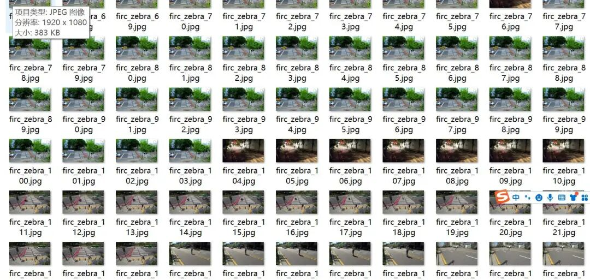
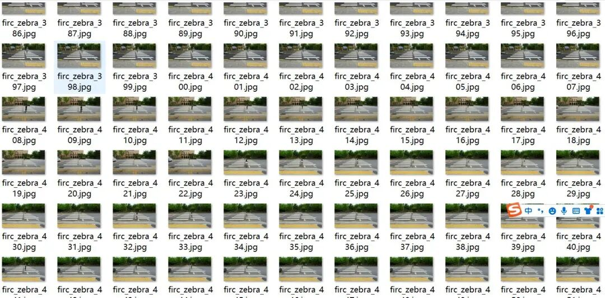
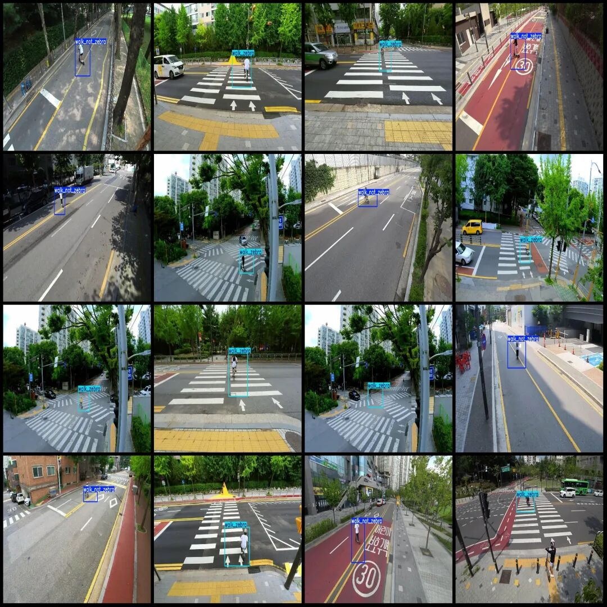
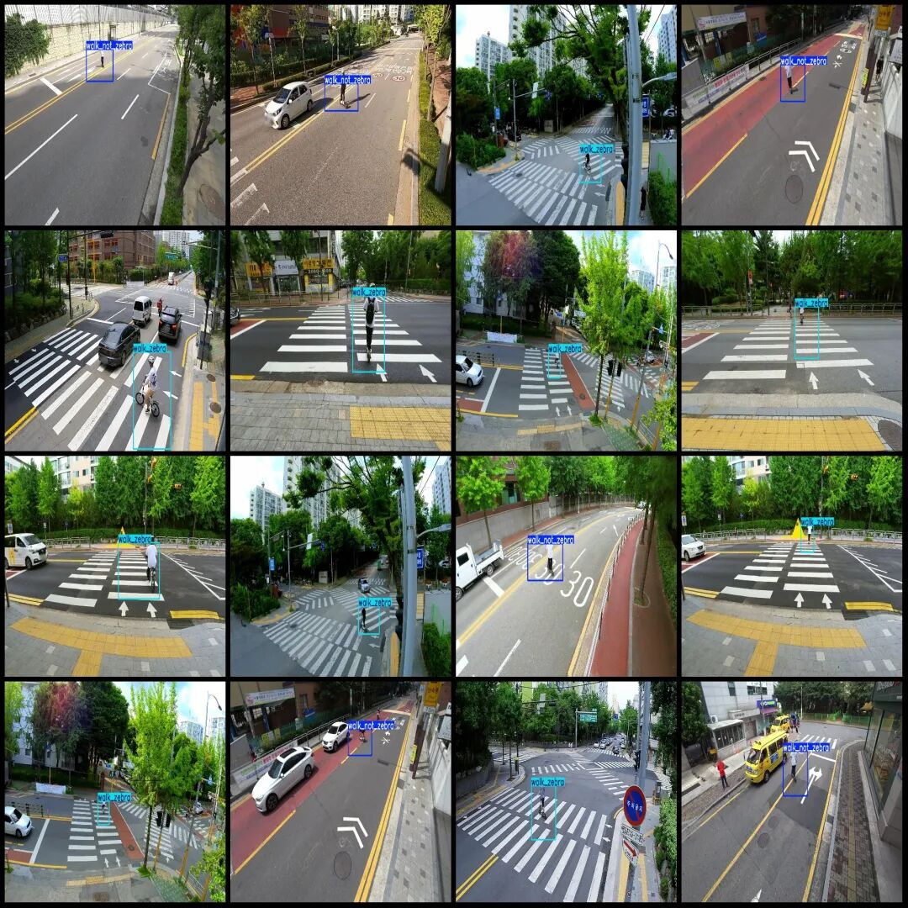

# Intelligent Traffic Pedestrian Crossing Without Following Regulations Detection Dataset VOC+YOLO format with 757 images in 2 categories

Dataset format: Pascal VOC format + YOLO format (txt file without split path, only containing jpg images and corresponding VOC format xml files and yolo format txt files)

Number of images (number of jpg files): 757

Number of annotations (number of xml files): 757

Number of annotations (number of txt files): 757

Labeling category count: 2

Label category names (Note that the order of yolo format categories does not correspond to this, but is based on the labels folder's classes.txt): ["walk_not_zebra", "walk_zebra"]

Number of boxes labeled in each category:

Walk_not_zebra (Not crossing the road according to regulations) Frames = 346

walk_zebra (crossing the road at a zebra crossing) frame count = 411

Total frame count: 757

Image resolution: 1920x1080

Using labelImg:

Annotation rules: Draw a rectangle around the category.

Important Notice: The dataset does not have separate training, validation, and test sets; you need to partition them yourself.

Special : This dataset does not guarantee the accuracy of the trained models or weight files.

Image Preview:

Annotation example:

## Payment

Here is a pay link on Stripe ( https://buy.stripe.com/3cs8yP7sY87d0vu9AB ). Please contact me lonlonago@foxmail.com after funding $89, and I will send you a complete data files , thank you!

